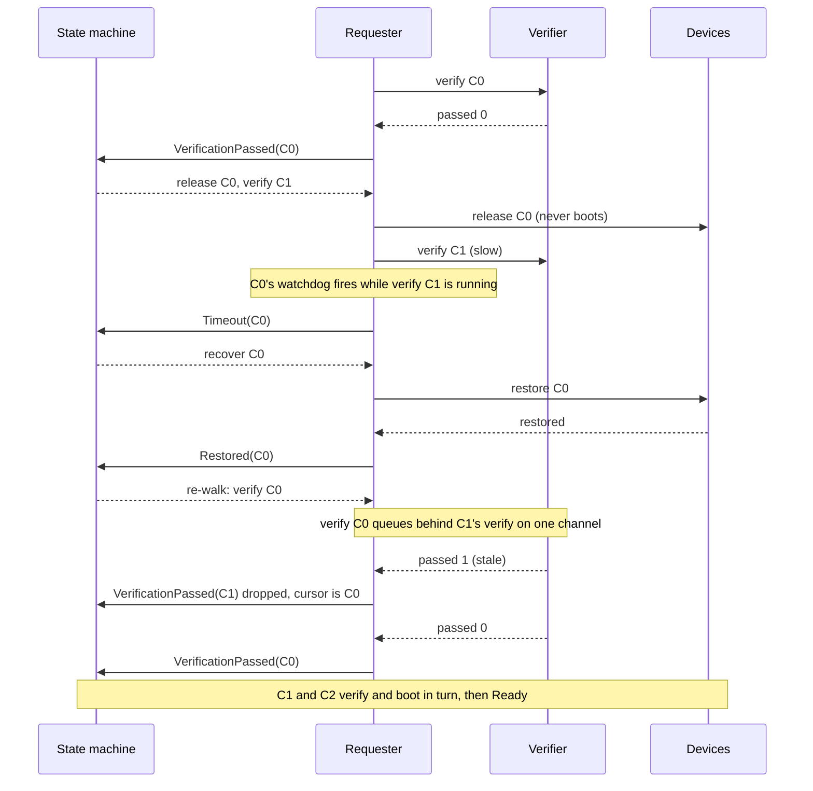

# Asynchronous Service Calls

How the orchestrator talks to several platform services at once without ever
blocking on one. The [Platform Architecture](./orchestrator-platform.md) page
states the rule: *commands are fire-and-forget; every reply returns as a queued
event.* This page is the mechanism that makes the rule true, and the
`async_sim` QEMU test is a running model of it. Each claim below is marked
**Shown** (the simulation exercises it) or **Not shown** (a design decision the
simulation does not yet test).

## Roles

| Role | Who | Loop | Why |
|---|---|---|---|
| **Requester** | the orchestrator | its own wait loop over `util_requester` lanes | it asks, many services at once, and must keep reacting to timers and events |
| **Executor** | each platform service (verifier, reset, storage, crypto, ...) | `util_service::ServiceLoop` | it answers requests on channels and may defer a reply |

`ServiceLoop` is a server loop. The orchestrator does not use it. Its sources
would be the *initiator* handles of its own calls, and a loop built for
handlers cannot meet the rules those need (see [Events from services](#events-from-services)).
The requester has its own, smaller loop, and everything it shares with other
clients lives in the `util_requester` crate.

## From effect to event

The state machine stays pure (see the [State Machine](./orchestrator-machine.md)).
The requester sits between it and the services:

```text
Orchestrator::dispatch_with(event, |effect| executor.effect(effect))
      effect  ──▶  command queued on one service's lane      (returns Ok(None))
      ...the loop sleeps...
      response lands  ──▶  decoded into an Event  ──▶  dispatch_with(event, ...)
```

`dispatch_with` already allows this: the closure returns
`Result<Option<Event>, EffectError>`, and `Ok(None)` means "no result yet".
The executor does no I/O inside the closure. It only queues a command, so a
dispatch always runs to quiescence at once. The result comes back later as an
ordinary event. **Shown** (in `async_sim` each effect is either queued on a lane or accepted locally, and nothing blocks).

`PlatformDriver` follows the same shape for verification. `VerifyFirmware`
calls `start_verify` on an `AsyncVerifier` and returns `Ok(None)`; the run
loop collects the verdict from `poll_verify` and dispatches it. A verifier that
passes its deadline reports `TimedOut`, which the driver turns into
`VerificationFailed`, so the machine recovers the component instead of locking.
Starting a check or re-staging the image cancels the one outstanding, so a
stale answer is never recorded or emitted. This is **Shown** on the host
(driver tests with a scripted slow verifier), not yet on QEMU. The short local
calls (reset lines, the SVN floor, reports) still complete inside `execute`.

## Lanes: one transaction per channel

A kernel channel carries one transaction at a time. The requester therefore
keeps one **lane** per service channel (`util_requester::Lane`):

- at most one command in flight;
- a small fixed-capacity queue of commands waiting behind it, started in the
  order they were pushed;
- the deadline the command in flight must meet.

A second command for the same service waits. A command for a different service
does not. The lane makes no syscall and reads no clock, so its rules run on a
host against a fake `AsyncTransport` (16 host tests). **Shown** (host tests for
ordering, a full queue, failed starts and polls, cancel, deadlines; and in
`async_sim`, where the verify for a re-walk queues behind a stale one).

## The wake loop

One thread, one WaitGroup. A lane's transport handle is in the WaitGroup while
a command is in flight on it. The loop:

1. starts whatever can start on every lane;
2. waits on the WaitGroup, with the earliest of the boot watchdogs and the
   in-flight deadlines as the wait's deadline;
3. on a wake, polls that lane, decodes the response, and dispatches the event;
4. drains expired watchdogs into `Timeout` events, and cancels any command
   that has run past its deadline.

Whether a handle could stay registered permanently, instead of being added and
removed per command, is **Not shown**: the simulation adds and removes, and no
test checked that a persistent registration would spin after a command
completes.

## Deadlines, cancel, and unknown outcomes

Every command that can hang gets a deadline when it starts. When it passes, the
requester cancels the transaction and tells the state machine the command
failed. In `async_sim` an abandoned verify becomes `VerificationFailed`. This
follows the platform rule that an operation with an unknown outcome counts as
failed. **Shown** (`verify_hangs`).

Two consequences of how a server defers a reply:

- **The late reply goes nowhere.** After a cancel, the server's later
  `complete` fails and the server carries on, so a stale answer cannot reach
  the next request. **Shown** (`verify_hangs`). The race where the reply lands at
  the instant of the cancel is **Not shown**.
- **A cancel does not free the server's side.** A deferred channel stays out of
  the executor's WaitGroup until it completes the old reply, so the next
  request on that channel is not read until then. A restarted verify waits
  behind the abandoned one. Executors should bound how long they defer, and
  the requester's deadline for a restart should allow for the wait. **Shown**
  (the `verify_hangs` timings are sized around it).

## Events from services

A service sometimes has news with no request outstanding: a device booted, a
component was corrupted. The design uses a **long-poll**, not a `USER` signal.

The requester keeps one request parked on a dedicated *events* channel. The
service defers it and completes it when it has something to report. The
requester decodes the answer into an event and immediately issues the next
request.

Why not a `USER` nudge on the call channel:

- `USER` is level-triggered and only the peer can clear it. The requester
  cannot quiesce its own copy, so its loop would spin from the nudge until the
  service answers the follow-up query. A service that dies with it set leaves
  the requester spinning until something joins the dead process.
- The call channel's completion (`READABLE`) and the nudge (`USER`) would share
  one handle and one WaitGroup mask, and a wake would not say which fired.

The long-poll keeps the signal on the channel's own completion path, so there
is nothing to clear and nothing to disambiguate. **Shown** (the devices
service's `events` channel: a parked `WaitBoot` completes when a device boots,
and the requester re-issues it).

Costs. It takes one channel and one parked request per event source. A service
that dies never answers, so the requester needs a backstop: a deadline on the
parked request, then cancel and re-issue, so it learns the service has gone.
**Not shown.**

## Stale and out-of-order events

An answer can arrive after the state machine has moved on. The state machine
already drops such events: during `PreSupervision` only the component under
verification (`chain[cursor]`) may be released, and `Timeout` for a component
that is not awaiting boot is ignored. The requester delivers events in the
order they land and leaves the judgment to the state machine. **Shown** in
the event trace of `flaky_boot`: a verdict for a component arrives after a
recovery has restarted the walk, and the run still ends in `Ready`. The test
asserts the ordering and the final state, not the drop itself.

## What the concurrency is, and is not

The state machine walks the chain one component at a time, so there is never
more than one verify in flight. What runs concurrently is **across services**:
the verifier works on the component being verified while the reset service and
the event channel serve components already released. This design does not give
parallel verification; that would need the state machine's cursor to change.
**Shown** (`flaky_boot`: a boot watchdog fires while a different component's
verify is still running).

## Executor requirements

Executors are ordinary `ServiceLoop` servers.

- Answer at once, or `defer` and `complete` later.
- A server whose only channel is deferred may still wait for its own deadline.
  This needed a fix in `ServiceLoop::next`: the kernel rejects a wait on an
  empty WaitGroup, so it now waits on a parked channel's handle instead.
  **Shown** (the simulated verifier is a single-channel server).
- Keep any deferral short. See *A cancel does not free the server's side*.

## What the simulation shows

`target/ast10x0/tests/orchestrator/async_sim/`: the real `orchestrator-sm`
core, a test-local executor on `util_requester`, a verifier service
(deferred replies) and a devices service (reset commands and the boot-event
long-poll).

The services decide how they behave, and the orchestrator never tells them.
Each device is an `openprot_device_model::DeviceModel` with a boot script (hang,
boot after a delay, boot then fail), and the verifier has a latency script per
component. Both are fixed when the image is built. The orchestrator can only
reset a device and listen, so it cannot shape the world it is judged against.
For the same reason one image runs one scenario, built from the same sources
with one build flag, and a failure names its scenario. Repeat a run with
`--runs_per_test`, not a loop: the scripts count from the start of the image.
The scenario tests are `exclusive`, because their timing margins are tens of
milliseconds on QEMU's wall clock and shrink when other QEMU runs share the CPU.

| Scenario | Claim shown |
|---|---|
| `flaky_boot`: a device that does not boot the first time, beside a slow verify | the boot watchdog fires during another component's verify; recovery runs; the late verdict is dropped; the re-walk reaches `Ready` |
| `verify_hangs`: a verify that outlives its deadline | the requester cancels and reports failure; the late reply goes nowhere; recovery runs; the re-walk reaches `Ready` |

`flaky_boot` as the test ran it (component 1's verify is slow, component 0 never
boots the first time):



A note the device model made possible. After a boot timeout the machine goes to
`Recovering`, which expects the platform to hold the component in reset while it
is restored. An executor that only sends "restore" and never "hold in reset"
looks fine against a fake that restarts a timer on every release. Against the
device model it does not: a second release of a device whose line was never
asserted is a no-op, so a hung device stays hung. The executor now holds the
device before it restores it. **Shown** (`flaky_boot`).

## Not shown, and open

- The events backstop (cancel and re-issue a parked request) and what the
  requester does when a service dies.
- Persistent WaitGroup registration, and the cost of per-command add/remove.
- A cancel racing the reply at the same instant.
- Many event sources, and the channel and memory cost of one parked request
  each.
- Running `PlatformDriver` against an IPC-backed `AsyncVerifier` (built on
  `util_requester`) on QEMU. Its `BootControl` stays a synchronous call; over
  IPC it would only report that a command was accepted, not completed.
- The recovery, update and attestation effects, which the driver still fails
  closed on and which need real services behind them.
- Sizing: command queue depth per lane against the effect and pending-event
  caps in the state machine (`E >= 2*N + 2`).
- The tests run on QEMU with margins of tens of milliseconds. Behaviour on
  hardware timing is untested.
