# PLDM firmware-update benchmark: source-level investigation

## 0. What is being reverse-engineered (scope and baseline)

| Item | Value |
|---|---|
| Subject | The PLDM firmware-update benchmark tests `test_firmware_update_benchmark_64k` and `test_firmware_update_benchmark_firmware`, run on the FPGA (`fpga_realtime`) HwModel |
| Source examined | `https://github.com/ashlynnlevenick/caliptra-mcu-sw`, branch `bench-upstream`, HEAD `de2bdf9c8` (2026-10-07), cloned read-only to `/tmp/bench-src/repo3` |
| Benchmark commits | 6 commits on top of `35408ebb8`: `6d9bc52a4` (UA instrumentation), `afd6ad83e` (64k on HwModel), `888b5bda9` (I3C polling), `6af8f98a9`, `674433605` (full-image payload), `de2bdf9c8` (prints image size) |
| Not examined | Your local `main` (`e37dd9d86`) is **not** the baseline for this report |

**Baseline check (asked mid-investigation).**
- `bench-upstream` and your local `main` have diverged. The merge-base is `0be2a9dd1`. The branch has 869 commits that `main` doesn't, and `main` has 751 that the branch doesn't.
- #1251 (`ab49ec7cf`, "Optimize PLDM transfer performance and add benchmark") is merged on your `main` but is **not an ancestor** of `bench-upstream`.
- `main` contains only an older emulator-only `test_firmware_update_benchmark_64k` (`tests/integration/src/test_firmware_update.rs:947` on main). It logs KB/s from the UA and has no tick instrumentation.
- On `main`, none of these exist: `test_firmware_update_benchmark_firmware`, `emulator/bmc/pldm-ua/src/bench.rs`, the `PLDM_BENCH` env var, the exit hooks, the `test-firmware-update-bench` feature, and the HwModel/FPGA benchmark path.
- So the tests, and the instrumentation behind your numbers, are not merged into your checkout. **All `file:line` references below are `bench-upstream@de2bdf9c8`.**

**Evidence labels:** **[SRC]** read directly in source. **[ARITH]** computed from your logged values plus source constants. **[INF]** inferred, not proven. **[UNK]** cannot be established from source.

**Not done:** I built and ran nothing. The observed values are yours, used as given. I don't have the exact `payload: N B` that the run logged for the full-firmware test. See §5.4.

---

## A. Executive summary

1. **Your 1.4x tick growth is a measurement artifact: the counter wrapped.** [ARITH] + [SRC]
   - The "MCU ticks" are not MCU ticks. They are the FPGA wrapper's **free-running 32-bit** `cycle_count` register divided by 100.
     - Register: `hw/model/src/fpga_regs.rs:104`, RTL at `hw/fpga/src/caliptra_wrapper_top.sv:1165`.
     - Divide by 100: `hw/model/src/model_fpga_realtime.rs:428`.
     - The core clock is configured at 18 MHz (`hw/fpga/fpga_configuration.tcl:14`).
   - The register wraps after 2^32 cycles, about 239.8 s at the measured 17.91 MHz. The 296 s run crossed that boundary once.
   - Nothing handles the wrap. `bench.rs:157` uses `saturating_sub`, which hides it as long as the end value is still larger than the start value.
2. **Your two runs agree on a single clock once the wrap is added back.**
   - 64k: 7,205,338 ticks × 100 / 40.23 s = **17.9104 MHz**.
   - Full: (10,074,713 + 2^32/100) × 100 / 296.055 s = **17.9103 MHz**. The 32-bit wrap contributes 42,949,672.96 ticks.
   - They agree to 5 significant digits. The corrected tick ratio (7.3590) equals the wall-clock ratio (7.3591).
3. **Both metrics measure the same interval** (first `RequestFirmwareData` served → `TransferComplete` received, `bench.rs:285`). The boundaries are not different.
4. **Corrected throughput is flat at about 9 B/1000 ticks (about 1.6 KB/s), not 9 → 46.**
   - There is no fixed overhead or batching effect: the two-point wall-clock intercept is −0.2 s, and the corrected-tick intercept is −0.5 %.
   - Each `RequestFirmwareData` chunk costs about **120 ms in both runs**. That is 120.1 ms for 335 chunks and 120.8 ms for 2,451 chunks, assuming 480,256 B.
5. **The transfer is strictly serial, with 196 bytes per round trip.**
   - The UA advertises `MAX_TRANSFER_SIZE = 196` and one outstanding request (`update_sm.rs:30-34`).
   - Each 196-byte chunk becomes **4 MCTP packets of 64 B payload** (`common/testing/src/mctp_util/common.rs:13`).
   - On FPGA, the host forwarder sleeps **5 ms after every I3C write** (`model_fpga_realtime.rs:259`). That is a provable floor of about 20 ms per chunk, roughly 17 % of the 120 ms.
   - The remaining ~100 ms per chunk is **not attributable from source alone** [UNK]. §G gives the instrumentation to split it.
6. **The 9 → 46 "improvement" should not be reported.** Fix the wrap handling first (§G), then re-run.

---

## 1. Entry points and execution

### 1.1 Test targets

Both tests are in `tests/integration/src/test_firmware_update.rs`, inside `mod test`.

| Test | Line | Body |
|---|---|---|
| `test_firmware_update_benchmark_64k` | 1152 | Payload `(0..64*1024).map(\|i\| i as u8)`, then `run_hw_benchmark("fixed 64 KiB payload", &image)` |
| `test_firmware_update_benchmark_firmware` | 1166 | Payload = real update flash image, then `run_hw_benchmark(&label, &image)` |
| `test_firmware_update_benchmark_full` (exists, not in your set) | 1187 | A different path: emulator process, real verify/apply/activate (`run_benchmark`, line 976) |

- Both of your tests share `run_hw_benchmark` (`test_firmware_update.rs:1095`) and `BENCH_FEATURE = "test-firmware-update-bench"` (line 1067).
- The only code difference is where the `image: &[u8]` comes from.

### 1.2 Registration, build and invocation

- **Registration.** Plain `#[test]` functions in package `caliptra-mcu-tests-integration`. They take `TEST_LOCK` and run under nextest.
- **Feature plumbing for `test-firmware-update-bench`:**
  - `platforms/emulator/runtime/Cargo.toml` (`= ["flash-boot","firmware-update"]`)
  - `platforms/emulator/runtime/userspace/apps/user/Cargo.toml` (adds `bench-skip-validation`)
  - `platforms/fpga/runtime/Cargo.toml:102-103`
  - `builder/src/features.rs`: both `EMULATOR_RUNTIME_TEST_FEATURES` and `FPGA_RUNTIME_TEST_FEATURES`
  - `builder/src/all.rs`: in `FEATURES_REQUIRING_HW_2_1_RUNTIME`, and in `is_firmware_update_feature`, which also emits a separate update flash image
- **Firmware source.** `start_runtime_hw_model` uses prebuilt bundle binaries when `CPTRA_FIRMWARE_BUNDLE` has the feature (`has_prebuilt_binaries`). Otherwise it builds a release runtime from source (`tests/integration/src/lib.rs:744-775`). `bench_runtime_image_size()` (`test_firmware_update.rs:1072`) mirrors that choice.
- **Nextest wiring.** The only reference to a benchmark test in `.config/nextest.toml` is line 141: `test(test_firmware_update_benchmark_64k)` in the `pr-emulator` exclusion list.
  - `_firmware` and `_full` are **not** excluded there.
  - No FPGA profile references any benchmark test. The benchmark is not wired into FPGA CI. [SRC]
- Commands: see §H.

### 1.3 Roles

| Role | Where it runs | Code |
|---|---|---|
| **Update Agent (UA)** | The test process on the FPGA host (aarch64 Linux). Not on the MCU. | `emulator/bmc/pldm-ua` (`PldmDaemon`, `update_sm.rs`, `discovery_sm.rs`), started in `run_hw_benchmark` |
| **Firmware Device (FD)** | The MCU RISC-V core on the FPGA, as a Tock userspace app | `runtime/userspace/api/pldm-lib` (`pldm_responder`, `pldm_initiator`, `fd_context.rs`), ops in `runtime/userspace/api/caliptra-api/src/firmware_update/pldm_fdops.rs` |
| Test glue | Host | `tests/integration/src/test_firmware_update.rs`, `common/testing/src/mctp_transport.rs`, `mctp_util/common.rs`, `i3c_socket.rs` |
| Host HwModel | Host, drives FPGA MMIO | `hw/model/src/model_fpga_realtime.rs`. `step()` (line 424) does `handle_i3c` (line 269) and `update_ticks`. `forward_i3c_to_controller` (line 224) is a thread. |
| MCTP (host side) | Host | The UA's `MctpPldmSocket` (`mctp_transport.rs`) uses `MctpUtil` to packetize, with a 64 B packet payload |
| MCTP (device side) | Tock kernel capsules | `runtime/kernel/capsules/src/mctp/{driver,mux,send,recv,transport_binding}.rs`. Driver `MCTP_PLDM_DRIVER_NUM = 0xA0002` (`driver.rs:22`). |
| I3C (device side) | Tock kernel driver | `runtime/kernel/drivers/i3c/src/core.rs`: TTI target, `MAX_READ_WRITE_SIZE = 256` (line 23), single `rx_buffer` and single `tx_buffer` |
| I3C (host side) | FPGA Xilinx I3C controller through `XI3CWrapper` | `forward_i3c_to_controller`, `handle_i3c` |
| FPGA staging flash | Host thread `run_imaginary_flash_controller_service` (`test_firmware_update.rs:1135`) | Not exercised for data when `bench-skip-validation` is active |

**Who initiates what.** The UA drives discovery, `RequestUpdate`, `PassComponentTable` and `UpdateComponent` (it sends them). From `UpdateComponent` onward the **FD becomes the initiator**: it sends `RequestFirmwareData`, `TransferComplete`, `VerifyComplete` and `ApplyComplete`. The UA answers each one.

### 1.4 Call path (test → UA → I3C/FPGA → Tock → back)

```mermaid
sequenceDiagram
    autonumber
    participant T as test fn (test_firmware_update.rs:1152/1166)
    participant HW as ModelFpgaRealtime (host, main thread)
    participant UA as UA threads: rx_loop, event_loop (pldm-ua)
    participant FWD as forward_i3c_to_controller thread
    participant I3C as FPGA I3C ctrl, 1 MHz SCL
    participant K as Tock kernel: i3c core.rs, MCTP mux/driver
    participant FD as FD userspace: pldm_initiator/responder

    T->>T: run_hw_benchmark(): build pkg, set PLDM_BENCH=1, PLDM_BENCH_SKIP_VALIDATION=1
    T->>HW: start_runtime_hw_model(feature=test-firmware-update-bench, release)
    T->>UA: PldmDaemon::run(...) -> bench::init(), spawn rx_loop + event_loop
    T->>HW: finish_runtime_hw_model() -> step_until_exit_success() loop
    loop every step()
        HW->>HW: handle_i3c(); update_ticks(cycle_count/100)
    end
    UA->>UA: sleep 2s (daemon.rs:182), mark DiscoveryStart
    UA->>K: discovery (SetTID/GetTID/...)
    UA->>K: QueryDeviceIdentifiers (mark UpdateStart), GetFirmwareParameters, RequestUpdate(max_xfer=196, outstanding=1)
    UA->>K: PassComponentTable, UpdateComponent
    K->>FD: MCTP rx -> pldm_responder -> FD state = Download
    FD->>FD: signal initiator; run_optimized_download() loop
    loop each chunk, strictly serial
        FD->>K: send_request(RequestFirmwareData offset,len<=196)
        K->>I3C: IBI + private read (1 pkt)
        I3C->>HW: IBI/read via handle_i3c (1 per step)
        HW->>UA: via i3c socket -> MctpUtil.receive -> rx_loop
        UA->>UA: on_request_firmware(): record_chunk() (first = DownloadStart)
        UA->>FWD: response (4 MCTP pkts x 64B), each send_private_write
        FWD->>I3C: write(), then sleep 5ms (per packet)
        I3C->>K: TTI RX -> handle_incoming_write -> mux reassembly
        K->>FD: RECEIVED_RESPONSE upcall
        FD->>FD: download_fw_data(): staging write skipped (bench-skip-validation)
    end
    FD->>UA: TransferComplete  (mark TransferComplete)  [END of reported interval]
    FD->>UA: VerifyComplete/ApplyComplete (set Success immediately), ActivateFirmware, then exit
    HW-->>T: firmware exit (UART byte on FPGA)
    T->>UA: run_exit_hooks(status) -> bench::finish() prints summary (line 1142)
```

---

## 2. Firmware-update sequence

UA sides cite `emulator/bmc/pldm-ua/src/update_sm.rs`. FD sides cite `runtime/userspace/api/pldm-lib/src/firmware_device/fd_context.rs`.

| Phase | Initiator | UA handler | FD handler | Data | In reported `download` metric? | Waits / retries |
|---|---|---|---|---|---|---|
| UA start delay | UA | `daemon.rs:182`, `sleep(2s)` | n/a | none | No (`DiscoveryStart` is marked after it) | Fixed 2 s sleep |
| Discovery | UA | `discovery_sm.rs` (not traced in detail) | pldm-lib `cmd_interface.rs:61` | PLDM base commands | No | First send waits for `FIRMWARE_PLDM_READY` (`mctp_transport.rs:75`, `wait_for_pldm_ready(50_000_000 ticks)`) |
| QueryDeviceIdentifiers | UA | `on_start_update` (l.212) → marks `UpdateStart` | `query_devid_rsp` (l.96) | Device UUID descriptor | No (negotiation row) | 3 s response timer, 3 retries (`update_sm.rs:38-39`) |
| GetFirmwareParameters | UA | `on_send_get_firmware_parameters` (l.444) | `get_firmware_parameters_rsp` (l.127) | FW params | No | same timer |
| **RequestUpdate** | UA | `on_send_request_update` (l.457) | `request_update_rsp` (l.151) | `max_transfer_size=196`, `max_outstanding=1`, image-set version string | No | same timer. FD negotiates `get_xfer_size = min(ua_size, MAX_PLDM_FW_DATA_SIZE=1019)` (`pldm_fdops.rs:82`) |
| **PassComponentTable** | UA | `on_send_pass_component_request` (l.254) | `pass_component_rsp` (l.208) | Component classification/id/stamp/version | No | same timer |
| **UpdateComponent** | UA | `on_send_update_component` (l.355) → `bench::set_component_size` | `update_component_rsp` (l.289) → `handle_component` (`pldm_fdops.rs`) | Component size (the payload length) | No | UA cancels its response timer on download start (`on_start_download`, l.637) |
| **RequestFirmwareData** (×N) | **FD** | `on_request_firmware` (l.665), `bench::record_chunk` | `run_optimized_download` (`pldm-lib/src/daemon.rs:286`) | Request: offset (u32), length (u32). Response: `length` bytes, UA-padded to ≥32 | **Yes**: first `record_chunk` → `TransferComplete` | Strictly 1 outstanding. FD T2 retry 5 s (`config.rs`), T1 120 s. UA does not retry data responses (`send_message_helper`, l.94) |
| TransferComplete | FD | `on_transfer_complete_request` (l.753) → `mark(TransferComplete)` | after `is_download_complete` | result code | End boundary | none |
| VerifyComplete | FD | `on_verify_complete_request` (l.798) | In skip mode `set_verification_result(Success)` immediately (`caliptra-api/.../firmware_update/mod.rs:145`) | result | No | none in skip mode |
| ApplyComplete | FD | `on_apply_complete_request` (l.921) | skip mode: `set_apply_result(Success)` immediately | result | No | none in skip mode |
| ActivateFirmware | UA | `on_activate_firmware` (l.989) | `activate_firmware_rsp` (l.380) | activation request/response | No | Real mode polls GetStatus every 1 s (`GET_STATUS_ACTIVATION_POLL_INTERVAL`). Skip mode ends after the response |

Notes:
- In skip mode `summary()` omits every phase after `TransferComplete` (`bench.rs:266`). Only `discovery`, `negotiation` and `download` print.
- `pldm_total` is also suppressed when validation is skipped (`bench.rs:303`).
- The first chunk is served via the regular handler. The rest use the optimized download path (`daemon.rs:216`). [SRC]
- In the optimized path the FD yields (`AsyncAlarm::sleep_ticks(1)`) only every 32 iterations (`YIELD_EVERY_ITERATIONS`, `daemon.rs:33`). [SRC]

---

## 3. Benchmark instrumentation

All in `emulator/bmc/pldm-ua/src/bench.rs` (new file in the branch, 322 lines).

| Question | Answer | Where |
|---|---|---|
| Starts MCU-tick measurement | `Recorder::now()` captures `Stamp{wall, ticks}` at each `mark()` / `record_chunk()` | `bench.rs:141-146`, `mark` l.191, `record_chunk` l.206 |
| Stops measurement | `mark(Milestone::TransferComplete)` in `on_transfer_complete_request` | `update_sm.rs:756` |
| Start milestone | `DownloadStart`: set by `record_chunk()` on the **first served chunk** (`or_insert`) | `bench.rs:209-211` |
| Wall clock | `std::time::Instant::now()` in the same `Stamp` | `bench.rs:143` |
| Tick source | `self.state.ticks.load(Relaxed)`: the host-side `EmulatorState.ticks` atomic | `bench.rs:144`, `common/emulator-state/src/lib.rs` |
| Who writes `state.ticks` | The **main test thread** in `ModelFpgaRealtime::step()`: `update_ticks(self.cycle_count() / 100)` | `hw/model/src/model_fpga_realtime.rs:428` |
| Emulator (non-FPGA) tick source | `update_ticks(self.cycle_count())` with no divisor | `hw/model/src/model_emulated.rs:643` |
| Delta | `e.ticks.saturating_sub(s.ticks)` and `saturating_duration_since` | `bench.rs:155-160` |
| Bytes per 1,000 ticks | `ratio(bytes*1000, ticks)` with `bytes = rec.component_size.unwrap_or(rec.requested_bytes)` | `bench.rs:228-231`, call at l.286 |
| Logging | `finish()` → `println!("{}", summary(...))`, via `run_exit_hooks(status)` | `bench.rs:313-321`, `test_firmware_update.rs:1142` |

**Which phase the "download" row is.** `throughput_row(.., "download", payload, t, s)` takes `rec.delta(DownloadStart, TransferComplete)` (`bench.rs:285`). The same `delta()` call returns both ticks `t` and wall seconds `s`, so **they cover exactly the same interval**. [SRC]

**Counter details**

| Property | Value | Evidence |
|---|---|---|
| Counter | FPGA wrapper `cycle_count`, `reg [31:0]`, increments each `core_clk` edge | `hw/fpga/src/caliptra_wrapper_top.sv:1165-1174` |
| Reset | Held at 0 while `cptra_ss_rst_b` is low. It is not reset per benchmark. | same, lines 1166-1169 |
| Width | **32 bits** (`ReadOnly<u32>`, widened with `as u64` and no extension) | `hw/model/src/fpga_regs.rs:104`, `model_fpga_realtime.rs:818-820` |
| Frequency | Configured `CORE_CLK_MHZ 18`, "Actual clock usually rounds down". **Measured 17.910 MHz** [ARITH] | `hw/fpga/fpga_configuration.tcl:14-15` |
| Reported tick unit | 100 core cycles ≈ **5.583 µs** per "tick" at 17.91 MHz | `model_fpga_realtime.rs:428`: "reduce effective speed" |
| Wrap | 2^32 cycles = 42,949,672.96 reported ticks ≈ **239.8 s** | arithmetic |
| Wrap handling | **None.** `saturating_sub` returns 0 if end < start, and silently returns a wrong-but-plausible value if end > start after wrapping | `bench.rs:157` |
| Sleep behaviour | Hardware counter on `core_clk`, independent of the MCU. WFI/blocking doesn't stop it. Config sets `CG_EN FALSE`. [SRC] The shipped bitstream setting itself is [UNK]. | `fpga_configuration.tcl:8` |
| Sampling | Stale by up to one `step()` period, because UA threads read the cached atomic, not the register | `update_ticks` |
| Tock kernel's own timer | `TIMER_FREQUENCY_HZ = 20_000_000` (`platforms/fpga/runtime/src/main.rs:41`). This is a different counter and **not** the benchmark source. It disagrees with the 17.91 MHz measured clock (side note). | |

**What is *not* an MCU tick.** Nothing in the benchmark reads an MCU timer. "MCU ticks" in the log are a host-sampled FPGA clock divided by 100.

---

## B. Measurement-boundary diagram

```mermaid
gantt
    dateFormat  X
    axisFormat  %s
    title What each metric covers (one run; not to scale)
    section Not measured
    Firmware build + package create (host)      :a1, 0, 2
    HwModel boot, I3C configure                 :a2, 2, 4
    UA fixed sleep 2s (daemon.rs:182)           :a3, 4, 5
    Discovery + QueryDevId + RequestUpdate + PassComponent + UpdateComponent :a4, 5, 7
    section Measured (ticks AND wall, same Stamp pair)
    first RequestFirmwareData served .. TransferComplete  :crit, m1, 7, 17
    section Not measured
    Verify/Apply/Activate (skipped on device)   :a5, 17, 18
    Firmware exit, exit hook prints summary     :a6, 18, 19
```



Precise start and stop points:
- **Start** = first `record_chunk()` (`bench.rs:206`). It is called from `on_request_firmware` (`update_sm.rs:721`) after the chunk response is built but **before** it is sent.
- **Stop** = `mark(TransferComplete)` (`update_sm.rs:756`), the first thing `on_transfer_complete_request` does.
- Both metrics read the **same two `Stamp`s**.
- The tick part is `state.ticks`, which is `cycle_count/100` as last written by the main thread. The wall part is `Instant`.

---

## 4. Test differences

`run_hw_benchmark` is shared, so **every setup, teardown, feature, buffer and timeout is identical**. The differences are payload content, size and how it is produced.

| Dimension | `_64k` | `_firmware` | Caused by |
|---|---|---|---|
| Payload source | Synthetic `(0..65536).map(\|i\| i as u8)` (l.1155) | `FirmwareBinaries::test_update_flash_image(BENCH_FEATURE)` from the bundle, else `create_update_package(BENCH_FEATURE, release)` which builds Caliptra FW + SoC manifest + MCU runtime + SoC images → flash image (l.1166-1180) | Code path (host-side, pre-timing) |
| Payload size | **65,536 B** (exact) | **Not given.** You wrote "469 KiB". The logged `payload: N B` and `firmware update image (N B payload)` give the exact value. Depends on the build. | Size |
| Chunk size | 196 B (`min(UA 196, FD 512, 1019)`) | 196 B | Same |
| Chunk count | ceil(65,536/196) = **335** | ceil(480,256/196) = **2,451** if 469 KiB = 480,256 B (2,393 if 469,000 B) | Size |
| Packets per chunk | 4 | 4 | Same |
| Negotiation | Identical (`RequestUpdate` 196 / 1) | Identical | Same |
| Setup | Pkg built with `image.to_vec()` in the manifest | Same, plus the image build | Host-side only, before the timed window |
| Staging flash writes | Skipped (`bench-skip-validation`: `pldm_fdops`/`ExternalFlash::write` returns `Ok`, `user/src/firmware_update/mod.rs:416`) | Skipped | Same. The device never stages data in either test. |
| Verification / apply | Skipped, returns Success immediately (`caliptra-api/.../mod.rs:145`) | Same | Same |
| Apply/activate/reset | None. Exit after the ActivateFirmware response | Same | Same |
| Logging | Same `println!`s in `handle_i3c`, same UA `info!` every ~1 KiB (`update_sm.rs:733`) | Same, ×7.3 the volume | Size |
| Timeouts | Same (UA 3 s×3, FD T1 120 s / T2 5 s) | Same | Same |
| Buffers | `MAX_MCTP_PLDM_MSG_SIZE=1024`, `MAX_PLDM_PAYLOAD_SIZE=1024`, I3C 256 | Same | Same |
| Compile-time features | `test-firmware-update-bench` → `flash-boot`, `firmware-update`, `bench-skip-validation` (user-app) | Same | Same |
| FPGA/board config | Same `fpga_realtime` HwModel, core_clk 18 MHz, I3C SCL 1 MHz (`fpga_configuration.tcl:18`) | Same | Same |
| Wrap exposure | Run ≈ 40 s, wraps only if the counter was within 40 s of 2^32 | Run ≈ 296 s > 239.8 s wrap period, **always** crosses a wrap | **Size, through a measurement defect** |

**Caveat on "skip".** [INF] The log line `device-side validation: skipped` is derived from the **host env var** `PLDM_BENCH_SKIP_VALIDATION` (`bench.rs:243`), not from what the device firmware was built with. I did not trace that the FPGA user-app receives `bench-skip-validation` from the runtime feature on every build path. The Cargo feature chain says it should (`apps/user/Cargo.toml`: `test-firmware-update-bench` includes it). If a build lost it, the FPGA would do real flash writes, which would be very slow. The per-chunk time agreement across both runs suggests it is consistent between them.

---

## 5. Explaining the results

### 5.1 Checking the calculations (from your logged values)

| Metric | 64k | Full (raw, as logged) | Full (wrap-corrected) |
|---|---|---|---|
| Ticks | 7,205,338 | 10,074,713 | 10,074,713 + 42,949,673 = **53,024,386** |
| Wall (s) | 40.23 | 296.055 | 296.055 |
| Implied clock (MHz) = ticks×100/wall | **17.9104** | 3.4030 | **17.9103** |
| Ticks → seconds at 17.9104 MHz | 40.23 | 56.25 | 296.06 |

- The 64k and wrap-corrected full values match at 5 significant digits (17.9104 vs 17.9103).
- The raw full-run value (3.40 MHz) is incompatible with the same hardware clock.
- The tick ratio goes from 1.398 (raw) to **7.359** (corrected). The wall ratio is 7.359. [ARITH]

**One-wrap proof.** The wall time is 296.055 s, which is 5.302×10⁹ cycles at 17.91 MHz. That is 1.2345 × 2^32 cycles, so exactly one wrap occurred (and the start stamp was below 3.29×10⁹ cycles ≈ 183 s after reset). The raw delta of 1.007×10⁹ cycles is 5.302×10⁹ − 2^32. [ARITH]

### 5.2 Why it is not the other candidates

See §F for the ranked list.

### 5.3 Why the wall-clock ratio is slightly above the payload ratio

- Wall ratio 7.359 vs payload ratio 7.328 (for 480,256 B). That is 0.4 %.
- Chunk count ratio is 2451/335 = 7.316 and the last chunk is partial. The per-chunk time is 120.09 ms vs 120.79 ms.
- This is within what we would expect from noise and the extra logging. It is **not** evidence of a fixed overhead. [INF]

### 5.4 The 46 vs 47.7 discrepancy in your own figures [UNK]

- With 469 KiB = 480,256 B, raw B/kilotick = **47.67**, not ~46.
- ~46 corresponds to about 463–469 kB. 469,000 B gives 46.55. That would make the payload ratio 7.16 rather than "roughly 7.3x".
- I can't tell which is right without the logged `payload: N B`. **The conclusion holds either way**, because it rests on the implied-MHz agreement, not on N.
- With N = 469,000 B the corrected value is 8.84 B/kilotick.

### 5.5 Latent defect: ticks can read 0 or garbage

- If the start stamp were later in the 32-bit window, `saturating_sub` would return **0** ticks, and `ratio()` (`bench.rs:220`) would print **0.000** B/kilotick.
- Any benchmark whose window straddles a wrap gets a wrong number. It is silent unless wall time is checked.

### 5.6 Adjacent hazard (not part of the benchmark numbers)

- `sleep_emulator_ticks` does `now - start >= wait` (`common/emulator-state/src/lib.rs`, plain u64 subtraction).
- On FPGA, if a wait spans the 239.8 s wrap, `now < start`. That panics in debug builds and wraps in release builds (the sleep ends early).
- `wait_emulator_ticks`, `wait_for_pldm_ready` and `emulator_ticks_elapsed` use `saturating_sub`. They are safe but would wait longer than intended.
- On FPGA, `wait_for_pldm_ready(50_000_000)` is 5×10⁹ cycles ≈ 279 s, which is longer than the wrap period.

---

## C. 64 KiB vs full-firmware (summary table)

| | 64 KiB | Full firmware |
|---|---|---|
| Entry | `test_firmware_update_benchmark_64k` (l.1152) | `test_firmware_update_benchmark_firmware` (l.1166) |
| Harness | `run_hw_benchmark` | `run_hw_benchmark` |
| Payload | 65,536 B synthetic | ~469 KiB real flash image (exact N: see logs) |
| Chunks (196 B) | 335 | 2,451 (if N=480,256) |
| MCTP packets (4 per chunk) | 1,340 | 9,804 |
| Logged ticks | 7,205,338 | 10,074,713 (**wrapped**) |
| Corrected ticks | 7,205,338 | 53,024,386 |
| Wall (s) | 40.23 | 296.055 |
| ms per chunk | 120.1 | 120.8 |
| Wall B/s | 1,629 | 1,622 |
| Device staging writes | skipped | skipped |
| Verify/apply/activate | skipped | skipped |

---

## E. Recalculated metrics

Assumes N = 480,256 B for "469 KiB". The alternative N = 469,000 B is in the last column.

| Metric | 64k | Full (raw) | Full (corrected, N=480,256) | Full (corrected, N=469,000) |
|---|---|---|---|---|
| Bytes per tick | 0.009095 | 0.047669 | **0.009057** | 0.008845 |
| Bytes per 1,000 ticks | **9.095** | 47.669 | **9.057** | 8.845 |
| Wall bytes/s | **1,629** | 1,622 | 1,622 | 1,584 |
| Wall KiB/s | 1.591 | 1.584 | 1.584 | 1.547 |
| Ticks per byte | 109.95 | 20.98 | 110.4 | 113.1 |
| Wall bits/s | 13,032 | n/a | 12,977 | n/a |

**Two-point linear fit (N = 480,256 B).**

| Quantity | Slope | Intercept |
|---|---|---|
| Wall time | 616.9 µs/B | **−0.20 s** |
| Corrected ticks | **110.48 ticks/B** (11,048 cycles/B) | **−35,203 ticks** (≈ −0.5 % of the 64k total) |
| Raw ticks (wrong) | 6.92 ticks/B | **+6,751,906 ticks** (≈ 37.7 s) |

- The raw-tick fit implies a ~37.7 s fixed overhead. The wall-clock fit contradicts it (−0.2 s). That is a second sign the raw ticks are wrong.
- **Estimated fixed overhead inside the measured window: effectively zero (±0.5 %).** The start boundary is after negotiation, so setup cost is excluded by construction.
- **Marginal cost: about 617 µs per byte, or about 120.8 ms per 196-byte chunk.**
- With N = 469,000 B the wall slope is 634 µs/B and the intercept is −1.3 s. This is still near zero, but less clean.

---

## F. Ranked explanations for the tick discrepancy

| # | Explanation | Verdict | Evidence for | Evidence against |
|---|---|---|---|---|
| 1 | **32-bit counter wraparound** | **Confirmed** [ARITH] | `ReadOnly<u32>` (`fpga_regs.rs:104`); RTL `reg [31:0]` (`caliptra_wrapper_top.sv:1165`); no extension in `cycle_count()` (l.818); `saturating_sub` (`bench.rs:157`); full run (296 s) > wrap period (239.8 s); wrap-corrected implied clock equals the 64k run's to 5 digits (17.9103 vs 17.9104 MHz); corrected tick ratio 7.3590 = wall ratio 7.3591 | None found |
| 2 | Different measurement boundaries | Rejected | | Both come from the same `delta()` call on the same two `Stamp`s (`bench.rs:285`). The two tests share `run_hw_benchmark`. |
| 3 | Timer frequency / conversion error | Rejected as the cause | The `/100` and the 18 MHz nominal vs 17.91 MHz measured are real caveats for **absolute** seconds | The same constant applies to both runs, and both give the same clock once the wrap is added |
| 4 | Fixed setup overhead | Rejected | | Window starts after discovery and negotiation. Wall intercept −0.2 s. Corrected-tick intercept −0.5 %. |
| 5 | MCU sleep / WFI not counted | Rejected | | The counter is wrapper RTL on `core_clk`, free-running (`:1165-1174`). It doesn't depend on MCU state. |
| 6 | Host-side waiting not in ticks | Rejected | | Ticks track wall time at a constant 17.91 MHz in both runs, so host waits are inside the ticks |
| 7 | Flash-operation timing | Rejected | | Device staging write is skipped (`user/.../firmware_update/mod.rs:416`) in both runs |
| 8 | Chunk-size difference | Rejected | | 196 B in both runs: `min(196, 512, 1019)` |
| 9 | Pipelining / batching | Rejected | | `MAX_OUTSTANDING_TRANSFER_REQ = 1` (`update_sm.rs:34`). The FD loop waits for each response (`daemon.rs:286`+). Per-chunk time is flat at 120 ms. |
| 10 | Logging overhead | Contributes, not the discrepancy | Per-IBI and per-read `println!` on the main thread (`model_fpga_realtime.rs:243, 295, 312`) | Per-chunk time is flat, so it scales with N and can't make ticks grow less |
| 11 | Benchmark calculation defect | **Partly**: the formula is right, the input is wrong | `bench.rs:228-231` divides correctly; `saturating_sub` hides the wrap | |

---

## 6. Performance limitations

| Topic | Finding | Evidence |
|---|---|---|
| Max outstanding requests | **1**. The UA advertises 1 (`update_sm.rs:34`), and the FD sends the next `RequestFirmwareData` only after processing the previous response. | `daemon.rs:286-400` |
| Request/response | Strictly request/response. `session.req_state` is `Sent` until the response is processed. | `transfer_session.rs` |
| Chunk size | **196 B** (250 − 14 − 32 − 8, `update_sm.rs:30`). The FD could take up to 1,019 B (`MAX_PLDM_FW_DATA_SIZE`) and `FD_MAX_XFER_SIZE=512`, but the UA caps it. | `update_sm.rs:30-34`, `config.rs:9`, `request_fw_data.rs:13` |
| MCTP packetization | The UA's `MctpUtil` uses `DEFAULT_PKT_PAYLOAD_SIZE = 64` (the MCTP baseline); `MctpPldmSocket` never calls `set_pkt_payload_size`. A 196 B chunk response is 201 B with the MCTP type byte → 4 packets (64/64/64/9). The device capsule MTU could be larger (I3C buffer 256). | `mctp_util/common.rs:13, 527`; `mctp_transport.rs` |
| Host I3C writes | Each packet goes via `send_private_write` → forwarder `controller.write()` → **`sleep(5 ms)` per packet**, plus a 1 ms poll loop waiting for FIFO space. About 20 ms floor per chunk. | `model_fpga_realtime.rs:245-260` |
| Host read path | The main thread's `handle_i3c` services **one** IBI or private read per `step()`. It stays strictly IBI → read → IBI → read. It `println!`s for each. | `model_fpga_realtime.rs:269-380` |
| Host sockets | Server loop polls with a 100 µs sleep when idle; the UA's `receive_packets` busy-polls the non-blocking stream | `i3c_socket_server.rs`, `mctp_util/common.rs:405+` |
| Device I3C queues | One `rx_buffer`, one `tx_buffer`, **one pending IBI** (`send_ibi` refuses if one is pending). `transmit_read` returns `BUSY` if the previous TX is unfinished. Buffer held until the IBI and the controller read both finish. | `i3c/src/core.rs:44-57, 275-278, 322-343` |
| Device retries | If no RX buffer, `set_alarm(RETRY_WAIT_TICKS=5000)` (≈0.28 ms nominal at 20 MHz) and retry | `core.rs:68, 159-169` |
| Buffer copies | UA: image → 196 B stack buffer → response encode → MctpUtil packetize (Vec) → socket → I3C. Device: TTI FIFO → kernel rx buffer → MCTP reassembly → process buffer (`allow_rw`) → `download_fw_data`. | `update_sm.rs:693`; `core.rs:157-217` |
| Tock syscalls per chunk | `send_request`: `GET_MAX_MESSAGE_SIZE` command, subscribe+allow_ro, `SEND_REQUEST` command, yield → `MESSAGE_TRANSMITTED` upcall. `receive_response`: subscribe+allow_rw, `RECEIVE_RESPONSE` command, yield → `RECEIVED_RESPONSE` upcall. About 3 commands, 2 subscribes, 2 allows, 2 yields, 2 upcalls per chunk. | `runtime/userspace/syscall/src/mctp.rs:149-218`; `kernel/capsules/src/mctp/driver.rs:26-35` |
| Flash-write granularity | One write per chunk (≤196 B) to staging. **Skipped in the benchmark.** | `pldm_fdops.rs:34-52` |
| UA timers | `send_message_helper` spawns a timer thread per **request** only. Data responses have no retry timer. | `update_sm.rs:94-130`, `timer.rs` |
| Locks | UA `update_sm` behind a `Mutex`; the device uses a critical-section `DOWNLOAD_CTX`; `bench::RECORDER` takes a `Mutex` per chunk (minor) | |

**Pipelining opportunities** (all would need a protocol change or a different UA):
1. **Packet size.** Raise the UA's packet payload from 64 B toward the device's real MTU (the I3C buffer is 256 B). That would cut the number of I3C writes per chunk, and with them the per-write 5 ms sleeps.
2. **Chunk size.** Raise `MAX_TRANSFER_SIZE` (196 B). The FD already supports up to 512 B negotiated, and 1,019 B by the encoded limit.
3. **Per-write sleep.** The unconditional 5 ms sleep after each I3C write is a "don't overwhelm firmware buffers" workaround. Replace it with FIFO-level flow control.
4. **Outstanding requests.** The PLDM spec allows more than 1 outstanding `RequestFirmwareData`; the UA advertises 1 and the device I3C driver has one rx buffer. Treat as a larger change.
5. **Main-thread work.** Move per-IBI `println!` out of `handle_i3c`, and service more than one IBI or read per step.

**Where the 120 ms per chunk goes: not provable from source** [UNK]. Only the 20 ms floor of host-side sleeps is [SRC]. The rest could be the main-thread `step()` cadence, UART/log output, socket hops, the 100 µs polling, device-side scheduling, or the 1 MHz I3C bus. The instrumentation in §G is needed to split it.

---

## G. Instrumentation changes that make the results unambiguous

1. **Extend the counter to 64 bits.** In `ModelFpgaRealtime::cycle_count()` (`model_fpga_realtime.rs:818`), keep `last_raw: u32` and `wraps: u64`. If `raw < last_raw`, increment `wraps`. Return `(wraps<<32)|raw`. It must be sampled at least once per wrap period (every `step()` already does that).
2. **Use wrapping math** for deltas in `bench.rs:157` (`e.wrapping_sub(s)` on the raw u32 cycle value), and **fail loudly** if the implied wall clock disagrees with the measured wall clock by more than a few percent.
3. **Log raw values at each stamp:** raw 32-bit `cycle_count`, `wraps`, `Instant` elapsed since `DiscoveryStart`.
4. **Log the implied clock** (cycles / wall seconds, MHz) in every summary row. It is the cheapest sanity check. It would have shown 3.40 MHz immediately.
5. **Rename the column** "MCU ticks" → "FPGA core cycles/100" (or log raw cycles). Make the divisor a named constant, and log it.
6. **Log chunk statistics:** chunk count, `max chunk`, and min/mean/p99/max per-chunk latency (UA request-received → response-sent, and FD send → response-received).
7. **MCU-side timing** (to separate device from host cost): read the Tock alarm/`mtime` in the FD before `send_request` and after `receive_response`, accumulate in `run_optimized_download`, and print total and per-chunk averages over the UART at download completion. Also record MCU-side cycles with `rdcycle`, if it is exposed.
8. **Host-side breakdown:** timestamp (a) IBI seen in `handle_i3c`, (b) response read forwarded, (c) UA `record_chunk`, (d) first and last packet written, (e) end of the 5 ms sleeps. Count packets and sleeps.
9. **Gate or remove** the per-IBI/read `println!`s in `handle_i3c` while benchmarking, or count them and report the total.
10. **Record the device build.** Log whether the firmware really was built with `bench-skip-validation` (device UART line at boot), and log the exact payload size and chunk count in the same summary block as the tick figures.
11. **Report only the `download` row for B/kilotick**, plus the `chunk_loop` row, and keep wall B/s alongside.

---

## H. Commands (only what repo files establish)

Nothing in CI or the docs runs the benchmark tests. The commands below are assembled from `docs/src/fpga.md`, `docs/src/testing.md`, `.github/workflows/fpga.yml`, `xtask/src/main.rs:303-331` and `xtask/src/fpga/mod.rs:179-190`. The two test names and the nextest package name `caliptra-mcu-tests-integration` come from the repo. I haven't run any of them.

**Emulator-backed HwModel (no FPGA).** [INF: derived from the nextest filter syntax in `.config/nextest.toml` and `xtask test --test-filter`]
```shell
cargo xtask test --test-filter 'test(test_firmware_update_benchmark_64k)'
cargo xtask test --test-filter 'test(test_firmware_update_benchmark_firmware)'
```
- `xtask test` runs `cargo nextest run`, and the default profile is `emulator`.
- Note that `pr-emulator` excludes the 64k test (`.config/nextest.toml:141`).
- To see the benchmark summary the output must not be captured. I did not verify how `xtask test` handles capture.

**FPGA host.** Based on `docs/src/fpga.md:160-166` and `.github/workflows/fpga.yml`:
```shell
cargo xtask-fpga fpga bootstrap --target-host $FPGA_HOST --configuration subsystem   # once per boot
cargo xtask-fpga fpga build --target-host $FPGA_HOST --configuration subsystem \
    --separate-runtimes --runtime-features test-firmware-update-bench
cargo xtask-fpga fpga build-test --target-host $FPGA_HOST --configuration subsystem
cargo xtask-fpga fpga test --target-host $FPGA_HOST --test-output \
    --test-filter 'package(caliptra-mcu-tests-integration) and test(test_firmware_update_benchmark_64k)'
cargo xtask-fpga fpga test --target-host $FPGA_HOST --test-output \
    --test-filter 'package(caliptra-mcu-tests-integration) and test(test_firmware_update_benchmark_firmware)'
```
- `--runtime-features` and `--separate-runtimes` exist (`xtask/src/fpga/mod.rs`), and `test-firmware-update-bench` is in `FPGA_RUNTIME_TEST_FEATURES` (`builder/src/features.rs`).
- Which exact `fpga build` flags you used for your observed run is [UNK].
- If no bundle contains the feature, the test builds a release runtime from source on the host. That is slow on the FPGA host (`docs/src/fpga.md` recommends building elsewhere).

---

## Appendix: key facts quick reference

- UA max transfer: `250 − 14 − 32 − 8 = 196` (`update_sm.rs:30`; `REQUEST_UPDATE_REQUEST_FIXED_HEADER_LEN=14`, `PLDM_FWUP_IMAGE_SET_VER_STR_MAX_LEN=32`).
- `BASELINE_TRANSFER_SIZE` 32 B. Responses shorter than 32 B are zero-padded by the UA (`update_sm.rs:693-715`).
- UA response timeout 3 s, max 3 retries (`update_sm.rs:38-39`). FD T1 120 s, T2 5 s (`pldm-lib/src/config.rs:10-11`).
- `MAX_MCTP_PLDM_MSG_SIZE = 1024`, `MAX_PLDM_FW_DATA_SIZE = 1019` (`request_fw_data.rs:13`).
- MCTP baseline unit 64 B (`base_protocol.rs:21`). I3C TTI buffer 256 B (`core.rs:23`).
- I3C SCL configured at 1,000 kHz (`fpga_configuration.tcl:18`).
- One "tick" in the log ≈ 5.583 µs at 17.91 MHz. One "kilotick" ≈ 5.58 ms.
- Wrap period ≈ 239.8 s at 17.91 MHz (238.6 s at a nominal 18 MHz).
